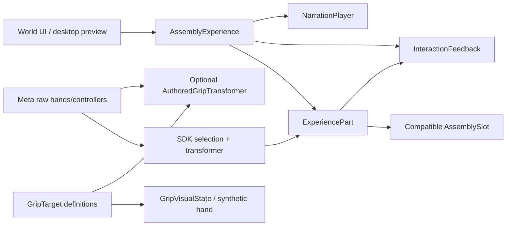

# Architecture

The demo has one workspace frame, one experience controller and one mechanical owner per moving part.

`ExperiencePart` manages free/held/seated/animating state, safe release, slot occupancy and recovery. `AssemblyExperience` owns explode/reassemble/inspection/reset orchestration. All assembly destinations are transforms under the workspace, separate from table homes. No model pivot is inferred as a thread axis or mounting point.

`AssemblySlot` tests compatibility, vacancy, distance and orientation. The demo snaps on release. A downstream held-snap fastener should explicitly switch into a constrained mechanical transformer while preserving raw wrist input; it must not teleport a still-free-grabbed object every frame.

`AuthoredGripTransformer` uses the SDK free transformer by default. Fixed Visual Wrist definitions can opt into smooth object-to-raw-wrist fitting. Pair fitting keeps the object rigid. Fingers Only leaves object pickup to the SDK. Imported model scaling belongs beneath an editable uniformly scaled interaction root.

The rig uses official package prefab references. `DesktopPreview` routes simulated pointer events through `Grabbable`, and activates a distinct desktop camera/EventSystem when XR is unavailable. It does not pretend to supply tracked hands.

UI uses uGUI world-space graphics plus Meta ray/poke surfaces. Four serialized callbacks control the experience. The inspection panel follows selection without changing assembly state.

Audio is observational. A small voice pool plays newly synthesized pickup, release, seating, reset, button and completion sounds. `NarrationPlayer` supports audio-timed caption cues, cancellation and guidance policy. No training narration or instructional videos are supplied.

Grip Editor, runtime grip data and the bounded Editor bridge are separate from the demo's domain logic. Their source provenance is recorded in `Reports/REUSED_FILES.json`.
