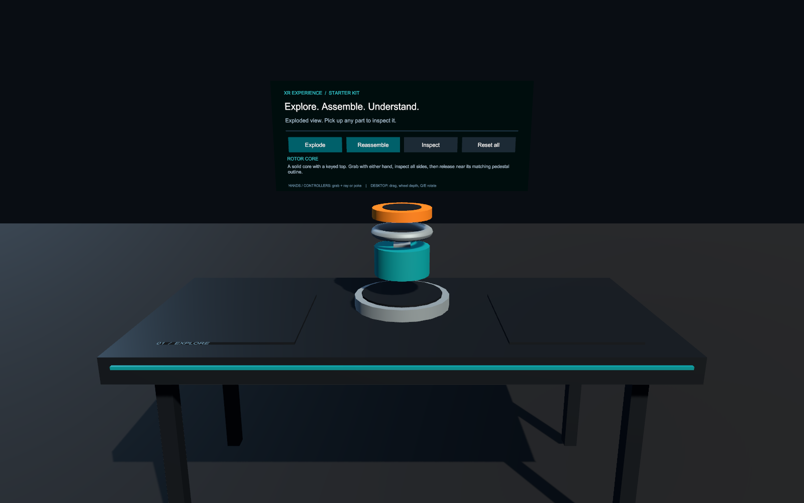

# Unity XR Experience Starter Kit

A working Unity foundation for XR training, simulation, assembly inspection and product exploration. Built from the interaction lessons and owner-authorized tools of a production training project, with a new generic scene and original feedback sounds.

**Unity 2022.3.62f2 · Built-in / Linear · Meta Interaction SDK 77 · OpenXR 1.14.3**

## Run the demo

1. Install **Unity 2022.3.62f2** through Unity Hub. Add Android Build Support, SDK/NDK and OpenJDK for Quest builds; Windows Build Support for desktop builds.
2. Clone this repository anywhere. In Hub, add **`UnityXRTemplate/`**, not the repository root. Allow UPM to resolve the committed manifest and lock file. A Unity license and Internet access are required for first import.
3. Open `Assets/StarterKit/Scenes/ExperienceDemo.unity` and press Play.
4. Without a headset, the desktop preview activates: **drag** a part, **mouse wheel** adjusts depth, **Q/E** rotates it. Click the panel controls. With a supported headset, use hands or controllers to grab; use ray or poke for UI.
5. Release a part near its matching outline. Try **Explode**, **Reassemble**, **Inspect**, and **Reset all**. Dropped parts automatically return after settling below the workbench recovery floor.

The demo is a three-part generic module. Its geometry and tolerances illustrate interaction design; they are not engineering specifications. Desktop pointer simulation is explicitly separate from tracked-hand or controller acceptance.

## Included

- Saved scene, configured XR rig prefab, pinned UPM packages, fresh portable project settings and `.meta` files.
- Hand/controller grabbables, compatible slots, progress/completion feedback, inspection and interruptible authored motion.
- Original synthesized spatial interaction sounds; narration/subtitle integration component ready for owned recordings.
- Owner-authorized **Grip Editor**: fingers, individual joints, mirrored poses, axis-specific wrist authoring, scale-aware positioning and runtime adapters.
- Project-local, bounded file bridge; native Unity batch CLI wrapper; focused agent skills.
- Meaningful Edit/Play tests and extraction/validation reports. **The starter journal is deliberately empty.**

## Targets and limits

Configured for Meta Quest 2, Quest Pro, Quest 3 and Quest 3S using controllers and/or optical hands, plus Windows desktop preview and OpenXR Link workflows. Other OpenXR headsets need a different input adapter and device validation: this is not an XRI-based universal rig. The demo uses an opaque studio, not mandatory passthrough or spatial anchors.

Read [the validation report](Reports/VALIDATION.md) for what was actually run. Editor checks and screenshots do not establish headset performance, tracking quality or stereo acceptance.

## Start a new experience

Duplicate the demo or create your own scene, retain the rig/services and replace only the generic assembly. Keep final mating poses separate from staging and intermediate motion. Author grips on positive, uniform-scale interaction wrappers. Add domain-specific completion rules without coupling them to media or tool return. Follow [architecture](Docs/ARCHITECTURE.md), [interaction contracts](Docs/INTERACTION_CONTRACTS.md), and [the extension workflow](Docs/NEW_EXPERIENCE.md).

Agents should read [AGENTS.md](AGENTS.md), then the smallest matching skill under `.agents/skills/`. The kit supports **either** native Unity CLI **or** its local bridge; both are not required. See [connections](Docs/CONNECTIONS.md).

## Ownership and dependencies

Authored kit code and owner-authorized reused tools use [MIT](LICENSE). Unity and Meta dependencies retain their own licenses and resolve through UPM; they are not vendored or relicensed. No production models, client UI, narration, textures or confidential training material are included. See [redistribution](Docs/REDISTRIBUTION.md) and [notices](THIRD_PARTY_NOTICES.md).
